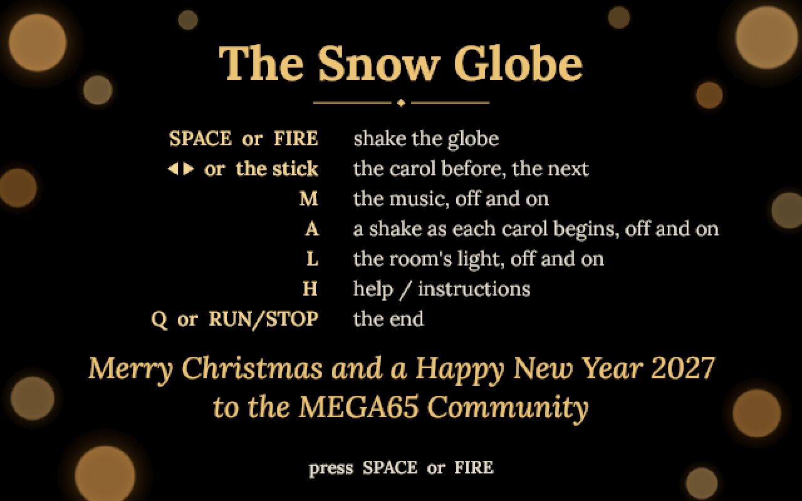
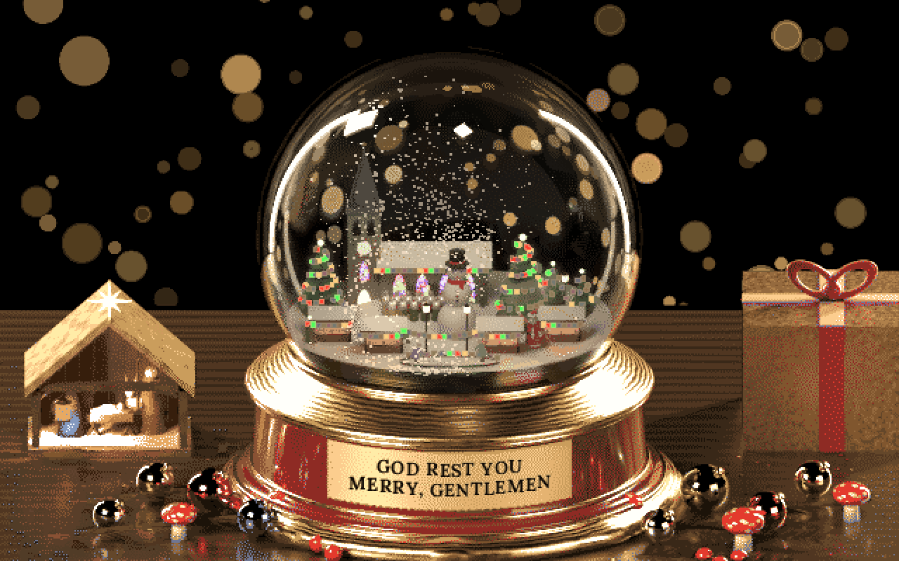
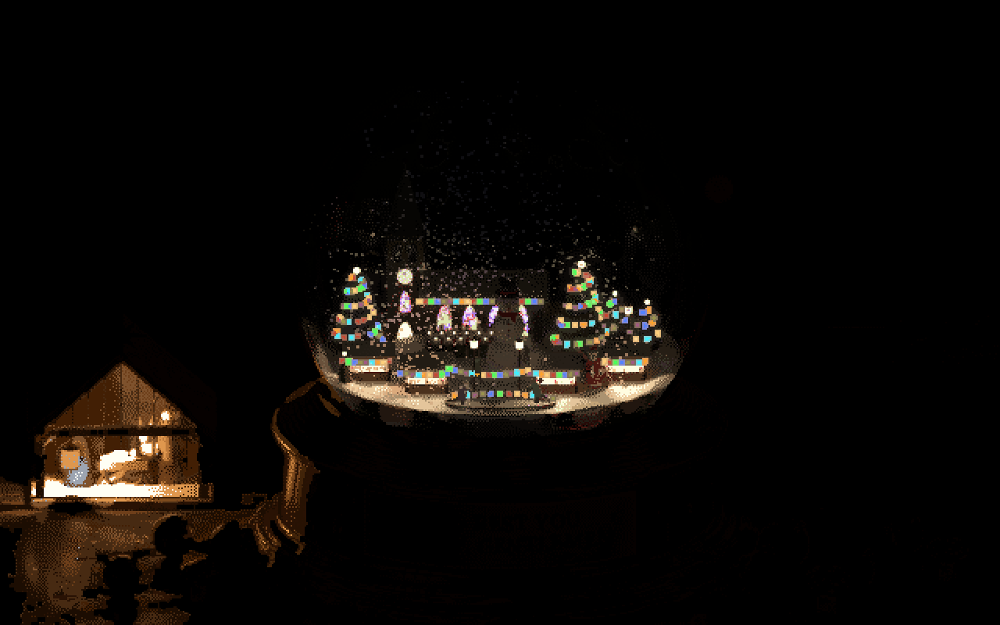

# The Snow Globe

A Christmas market in a globe of water, its snow simulated, and a music box playing the old carols.
For the MEGA65.

Shake the globe and the water turns, eddies form behind the houses, and the flakes swirl, sink and
settle on the roofs, the trees and the ground. Inside, people walk the lane, two skaters circle the
rink, Father Christmas waves and the market's lights twinkle. The music box plays 128 carols whose
music is free everywhere, each title engraved on the brass plaque. Turn the room's light off and only
the globe's own lights remain, and the candle in the stable, still flickering over the Holy Family.

Merry Christmas and a Happy New Year 2027 to the MEGA65 Community.

Version 1.0, 7 November 2026.

A 50-second video, with sound: [docs/the-snow-globe.mp4](docs/the-snow-globe.mp4). The splash with the
keys, then the globe: the snow settling, a shake, the room's light off and on again, the next carol.

## Run

Needs a MEGA65 with its attic RAM (the program checks), in PAL (50 Hz): the snow and the music are
timed by the frame, and NTSC has not been tried.

1. Download `SNOWGLOBE.D81` from the [latest release](https://github.com/psincosoft/snow-globe/releases/latest)
   and copy it to the SD card.
2. `MOUNT "SNOWGLOBE.D81"`
3. `LOAD"*",8,1`, then `RUN`

The disk's SHA-256: `b837f20b39115bf8235821ccf4fd2614e4a2c750392eda5c9de252e663ec2138`.

The opening card; the files load; the splash with the keys and the season's wishes, until SPACE or
FIRE; then the globe. While it runs it borrows the memory of the ROM's copy (the hypervisor lifts
its protection) and puts everything back when it ends; if the hypervisor refuses, the program says so
and ends.

## Keys

| Key | What it does |
|---|---|
| SPACE or FIRE | shake the globe |
| CRSR left and right, or the stick | the carol before, the next |
| M | the music, off and on |
| A | a shake as each carol begins, off and on (on at the start) |
| L | the room's light, off and on |
| H | help / instructions: the splash again, the globe paused; SPACE or FIRE: back to it |
| C | the CPU meter: the border lit while the engine works on a frame |
| Q or RUN/STOP | the end: BASIC's screen as it was |

Both joystick ports work. RESTORE and the Freezer silence the SIDs; the music comes back at once.

## What is in it

- **The snow.** 1,024 flakes in water with glycerol, each simulated in three dimensions, frame by
  frame, by our engine in machine code on the MEGA65's 40 MHz processor: they sink at their size's
  speed, ride the water's swirl and the eddies a shake leaves behind the houses, settle where they
  land and slide off what is too steep. A shake throws the settled snow up again. Each flake is drawn
  every second frame, in front of or behind the market by its depth.
- **The market.** The church and its choir, the stalls, the trees, the snowman, the rink, and strings
  of coloured lights that twinkle. A mother and her child and a man with a parcel walk the lane, two
  skaters circle the rink, Father Christmas waves.
- **The room.** A nativity stable whose candle flickers, golden lights behind, out of focus, slowly
  fading in and out. L turns the room's light off and fades the picture to the dark one.
- **The music box.** 128 carols, shuffled, every one before any repeats, most of them played twice;
  plucked on twelve voices of the four SIDs, the comb's click and its ring. The title is engraved on the
  plaque letter by letter and fades. No samples. The carols and their makers: [CAROLS.md](CAROLS.md).
- **The picture.** The scene is rendered with Blender from a scene built in code, and shown on the
  80 x 50 text screen in full-colour characters: 640 x 400 pixels in 256 colours, with a second
  palette for the room in the dark.

## Pictures

The pictures and the video are made on a PC from a model of the program that its engine matches byte
for byte, every frame; the sound is the same writes to the SIDs, played through four emulated 6581s.
They are not photographs of the machine.

## Tested on

A MEGA65 (R6A) in PAL, core 890-sdcard-native build #63 (commit 1c737937), ROM 920422.

## Credits

The Snow Globe 1.0, 2026, by Dawid Blachowski, with Claude, Anthropic's AI.
psinco. A Software Atelier from Luxembourg.

- Written with Claude, Anthropic's AI, which wrote the code, built the scene, arranged the carols and
  drew the splash under Dawid Blachowski's direction.
- The scene rendered with Blender.
- The carols: music by composers and arrangers who died before 1926, published before 1931; the words
  not used. Read from Benjamin Bloomfield's collection of Christmas carols (LilyPond), which its maker
  gives to the public domain. Each carol and its makers: [CAROLS.md](CAROLS.md).
- The titles and the splash: the Lora typeface (Cyreal), SIL Open Font License 1.1.
- Made with Python, NumPy, SciPy, OpenCV, Pillow, scikit-learn, py65 and LilyPond; tested in Xemu;
  the video with FFmpeg and reSIDfp.

## Terms

The Snow Globe is free, under the MIT licence: see [LICENSE](LICENSE). Its source code is not
published.
